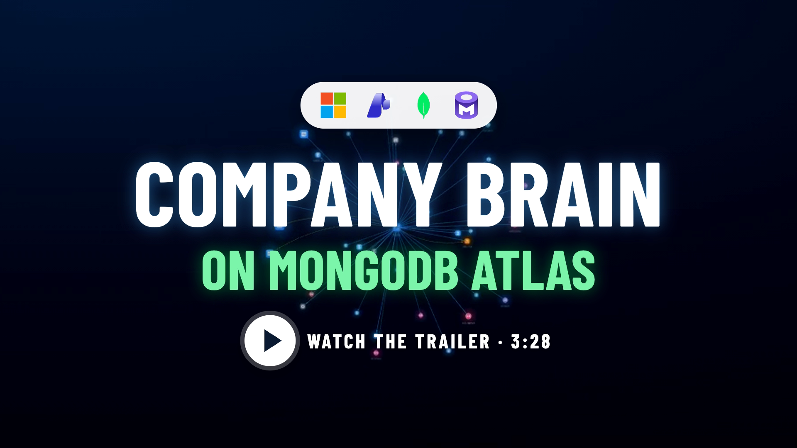
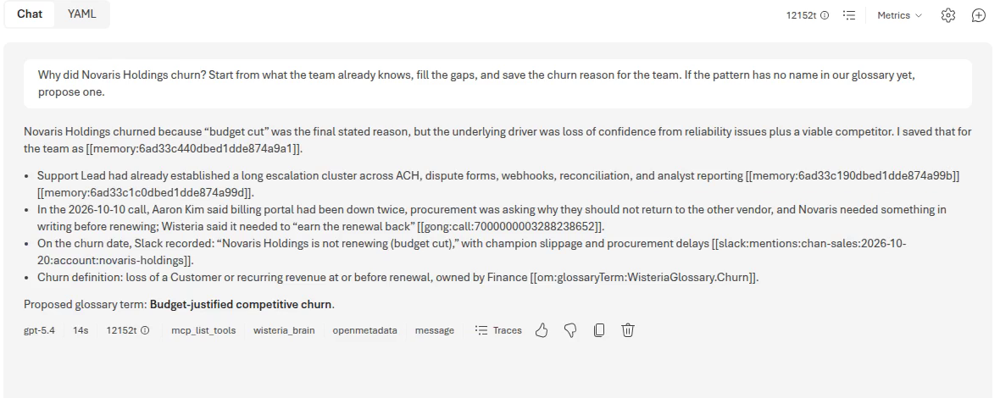
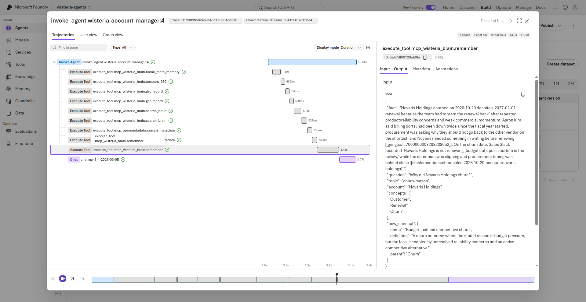
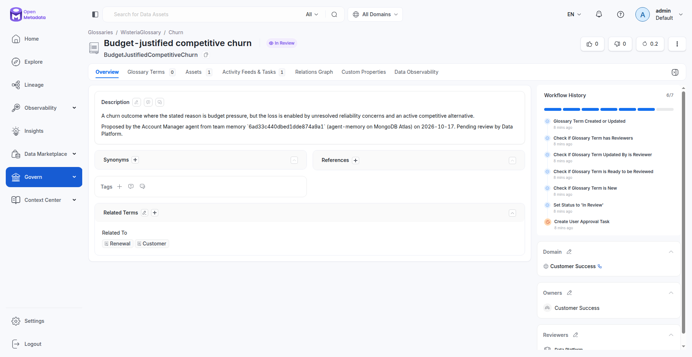
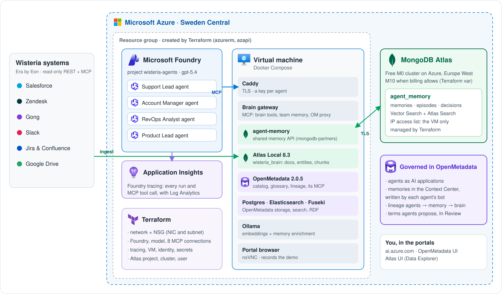

<div align="center">

&nbsp;&nbsp;&nbsp;&nbsp;&nbsp;&nbsp;&nbsp;&nbsp;&nbsp;&nbsp;&nbsp;&nbsp;&nbsp;&nbsp;&nbsp;&nbsp;

# Company Brain on MongoDB Atlas

**Microsoft Foundry agents that share one memory on MongoDB Atlas, with every answer governed by OpenMetadata.**

[](#microsoft-foundry-agents)
[](#the-brain-on-mongodb-atlas)
[](#governed-by-openmetadata)
[](infra/azure/README.md)
[](#model-context-protocol)
[](packages/brain)

[Overview](#overview) · [Demo](#demo) · [Architecture](#architecture) · [Getting started](#getting-started) · [Deploy to Azure](#deploy-to-azure) · [How it works](#how-it-works) · [Security](#security) · [Resources](#resources)

</div>

---

## Overview

Ask *"What changed at Wisteria this quarter?"* and the answer lives in six systems that never share an id. This repository
builds a **company brain** for Wisteria Group, the synthetic B2B fintech served by Era by Eon (20,000
employees, 6,000 customers), and runs it on Azure:

- **One brain on MongoDB Atlas.** Salesforce, Zendesk, Gong, Slack, Jira, Confluence and Google Drive land as documents,
  resolved entities and embedded chunks, searched in one stage with `$rankFusion` (Atlas Search + Vector Search) and walked
  with `$graphLookup`. Every claim is cited back to its record.
- **Four role agents in Microsoft Foundry** (Support Lead, Account Manager, RevOps Analyst, Product Lead) on gpt-5.4.
  They share **one memory** through [agent-memory](https://github.com/mongodb-partners/agent-memory) on MongoDB Atlas: each
  agent recalls what its teammates saved, investigates only the gaps, and remembers what it learned.
- **Governed by OpenMetadata.** Definitions, owners, lineage and PII tags come from the catalog at answer time, over MCP.
  Every memory is mirrored to OpenMetadata's Context Center, written by the agent's own bot, and agents **grow the
  ontology** by proposing glossary terms that go *In Review* for Data Platform.
- **Traced and reproducible.** Application Insights traces every run and MCP tool call in Foundry, and the whole stack
  (network, Foundry, VM, tracing and the Atlas cluster) is **Terraform**.

## Demo

<a href="https://youtu.be/ZqHK3OrAy4I"></a>

A 3½-minute trailer cut from a take in the real portals. After a Microsoft × MongoDB opener comes OpenMetadata 2.0's **Knowledge Graph** ("every
company already has a brain"), then the brain scattered across the six Era by Eon systems, then the four
**personas** (the Support Lead, Account Manager, RevOps Analyst and Product Lead agents in **Microsoft Foundry**), and a
beat for each capability: every tool call traced, every memory governed, column-level lineage, governed metrics,
the Data Marketplace, a glossary term an agent proposed and the Ontology Explorer, with the memory itself on a
**MongoDB Atlas** cluster on Azure. Watch it on [YouTube](https://youtu.be/ZqHK3OrAy4I) or download the
[mp4](docs/demo/wisteria-portal-demo.mp4); the full take with every caption is the
[walkthrough](docs/demo/wisteria-portal-walkthrough.mp4) (5½ minutes). Re-record it with
[`infra/azure/demo/record-portal.sh`](infra/azure/demo/README.md). Music: "Heroic Motif" (made with Suno).

| Foundry: the agent names a pattern | Foundry tracing: every tool call | OpenMetadata: the proposed term |
|---|---|---|
|  |  |  |

## Architecture



| Layer | Technology | Role |
|---|---|---|
| Agents | **Microsoft Foundry** prompt agents, gpt-5.4 | Support Lead, Account Manager, RevOps Analyst, Product Lead |
| Tools | **Model Context Protocol** over HTTPS, one key per agent | Company-brain tools + team memory; OpenMetadata read tools via each agent's bot |
| Shared memory | **agent-memory** on **MongoDB Atlas** (cluster on Azure, `$rankFusion`) | Short-term, long-term and episodic memory for all agents |
| Brain | **MongoDB Atlas** (Atlas Local 8.3 on the VM) | Raw records, docs, entity graph, chunks + embeddings |
| Governance | **OpenMetadata 2.0.5** (+ Postgres, Elasticsearch, Apache Jena Fuseki) | Glossary and ontology, owners, lineage, PII, AI assets, memories |
| Observability | **Application Insights** + Log Analytics | Foundry traces: every run and tool call |
| Infrastructure | **Terraform** (`azurerm`, `azapi`, `mongodbatlas`) | Network, Foundry, VM, tracing, Atlas project and cluster |

## Getting started

### Prerequisites

- Node.js 22, Docker (8 GB for the local stack), [Ollama](https://ollama.com) with `nomic-embed-text` and `qwen2.5:3b`
- An Era by Eon environment (the Wisteria Group tokens)
- For Azure: Terraform ≥ 1.9, the Azure CLI signed in to your subscription; optionally a MongoDB Atlas service account

### Run locally

```bash
npm install
cp .env.example .env
docker compose up -d                      # Atlas Local + OpenMetadata + agent-memory (about 3 minutes the first time)
npm run era:import -- --register          # Era tokens → .env (never printed) + MCP servers for Claude Code
npm run ingest                            # Era → Atlas (cached, re-runs are cheap)
npm run om:setup                          # OpenMetadata: ontology, sources, Atlas collections, lineage, owners, agents
npm run smoke                             # checks every layer without a model
npm run dev                               # API :8787 + web app http://localhost:3100
```

Model access for the local agent: `ANTHROPIC_API_KEY` in `.env`, or Microsoft Foundry (`CLAUDE_CODE_USE_FOUNDRY=1` plus
the `ANTHROPIC_FOUNDRY_*` variables). OpenMetadata: http://localhost:8585.

### Deploy to Azure

```bash
cd infra/azure/terraform
cp terraform.tfvars.example terraform.tfvars   # subscription, SSH key, your IP
terraform init && terraform apply              # ~3 minutes (an Atlas cluster adds ~10)
cd ../../..
./infra/azure/deploy.sh --data                 # ship the repo + data, bootstrap the VM, create the Foundry agents
```

No SSH from your network? [`infra/azure/push.sh`](infra/azure/push.sh) operates the VM through Azure Run Command.
To put the agents' memory on a **MongoDB Atlas cluster**, add an Atlas service account to `terraform/atlas.auto.tfvars`,
`terraform apply`, then `./infra/azure/memory-to-atlas.sh`. Full guide: [infra/azure/README.md](infra/azure/README.md).

## How it works

### The brain on MongoDB Atlas

| Collection | What it holds | Queried with |
|---|---|---|
| `raw_<system>_<object>` | Each vendor's JSON, verbatim | upserts by source id |
| `docs` | Citable units: ticket, call, thread, page, deal | indexes on account and time |
| `entities` | Accounts, people, products merged across systems | `$graphLookup` |
| `chunks` | Text + 768-d embeddings (Ollama `nomic-embed-text`) | `$rankFusion` of Atlas Search + Vector Search |

Seven tools (`search_brain`, `account_360`, `related_entities`, `what_changed`, `explain_data`, `get_record`,
`team_memory`) share one citation contract: every claim carries a record id such as `[[zendesk:ticket:4017504]]`.

### Microsoft Foundry agents

Each Foundry agent has two MCP tools: the **company brain** (its tools plus `recall_team_memory`, `remember`,
`team_activity`) and **OpenMetadata** (search, entity details, lineage, read-only, as the agent's own bot). Instructions
and tools live in [`packages/brain/scripts/foundry-agents.ts`](packages/brain/scripts/foundry-agents.ts); the VM creates
the agents with its managed identity. Application Insights on the Foundry account traces every run
([`tracing.tf`](infra/azure/terraform/tracing.tf)).

### Shared memory with agent-memory

All agents write to one memory space in [agent-memory](https://github.com/mongodb-partners/agent-memory) (REST + MCP),
which keeps memories, an episodic log and decisions in MongoDB, recalled with `$rankFusion`. On Azure it can run on its
own Atlas cluster ([`atlas.tf`](infra/azure/terraform/atlas.tf)) on Azure: a free M0 (the demo runs on one in Europe West)
or an M10 when billing allows, reachable only from the VM and browsable in the Atlas UI. To bill Atlas through an Azure
subscription, [`atlas_billing.tf`](infra/azure/terraform/atlas_billing.tf) links the organization to the Azure Marketplace
plan (MongoDB Atlas as an Azure Native ISV service).

### Governed by OpenMetadata

- **Semantics:** 27 business concepts with 18 typed relations, mapped to schema.org, FIBO, W3C ORG and FOAF; 5 governed
  metrics with the exact MongoDB aggregation behind each.
- **Physical:** 46 datasets with owners, domains and PII tags; 426 column-lineage mappings from Era to the agents.
- **AI assets:** the agents as AI applications, their MCP servers, runs, and memories in the Context Center, each written
  by the agent's bot (`support-lead-agent`, …) and linked to `agent_memory.memories`.
- **A growing ontology:** an agent can pass `new_concept` to `remember`; it becomes a glossary term under its parent,
  owned by the agent's team, *In Review* with an approval task for Data Platform.
- **Reasoning:** the catalog is projected into Apache Jena Fuseki; OWL reasoning finds every PII dataset an agent depends
  on from one-hop lineage (`npm run sparql -- 3 --compare`: 0 → 16 rows).

### Model Context Protocol

MCP runs in both directions: the brain is an MCP server (`npm run mcp`, or `/agents/<agent>/mcp` on Azure) for Foundry,
Claude, GitHub Copilot or any client; and the agents are MCP clients of OpenMetadata and Era.

## Security

- Internet-facing: only Caddy (TLS) on the VM. Atlas Local, agent-memory, OpenMetadata, Fuseki and Ollama stay on the
  Docker network; SSH is closed unless you enable it.
- Foundry uses Entra ID only (`disableLocalAuth`); the VM calls it with its managed identity.
- Each agent reaches the gateway with its own key, stored in a Foundry project connection; one agent's key opens no other.
- OpenMetadata bot tokens never leave the VM; only read tools pass. Agent bots may write memories and propose glossary
  terms, nothing else.
- The Atlas cluster accepts only the VM's IP; its database user is scoped to `agent_memory`.
- Secrets are generated by Terraform; keep its state private. Details: [infra/azure/README.md](infra/azure/README.md#security-model).

## Costs

While running: the VM (`Standard_D8s_v5`, about US$0.38/hour) and, with an M10 instead of the free M0, the
Atlas cluster (about US$0.10/hour) dominate; Foundry tokens and Application Insights are per use. Deallocate the VM between sessions and
`terraform destroy` when you are done.

## Repository layout

```
packages/brain/src      brain store, search, tools, agents, Foundry gateway, OpenMetadata integration, MCP server
packages/brain/scripts  ingest, om:setup, foundry-agents, team-reset, sparql, smoke
apps/web                web app: cited answers, evidence vine, /team
infra/azure             Terraform, VM bootstrap, Run Command tooling, portal browser, demo recorder
infra/*.compose.yml     OpenMetadata 2.0.5, agent-memory (pinned, hash-checked)
docs/                   demo video, design notes, assets
AGENTS.md               start here if you are a coding agent
```

## Resources

- [Microsoft Foundry documentation](https://learn.microsoft.com/azure/ai-foundry/) ·
  [Application Insights](https://learn.microsoft.com/azure/azure-monitor/app/app-insights-overview)
- [MongoDB Atlas Vector Search](https://www.mongodb.com/docs/atlas/atlas-vector-search/vector-search-overview/) ·
  [`$rankFusion`](https://www.mongodb.com/docs/manual/reference/operator/aggregation/rankFusion/) ·
  [agent-memory](https://github.com/mongodb-partners/agent-memory)
- [OpenMetadata](https://docs.open-metadata.org) · [Model Context Protocol](https://modelcontextprotocol.io)
- [Terraform MongoDB Atlas provider](https://registry.terraform.io/providers/mongodb/mongodbatlas/latest/docs)

## Author

**Roey Zalta**, Solution Engineer, Data & AI, Microsoft. Built for a MongoDB community session, October 2026.

> This is a demonstration, not an official Microsoft, MongoDB or OpenMetadata product. All Wisteria Group data is
> synthetic, served by Era by Eon.

## Trademarks

This project may contain trademarks or logos for projects, products, or services. Authorized use of Microsoft trademarks
or logos is subject to and must follow [Microsoft's Trademark & Brand Guidelines](https://www.microsoft.com/legal/intellectualproperty/trademarks/usage/general).
Use of Microsoft trademarks or logos in modified versions of this project must not cause confusion or imply Microsoft
sponsorship. Any use of third-party trademarks or logos (MongoDB, OpenMetadata, Terraform and others) is subject to
those third parties' policies.
